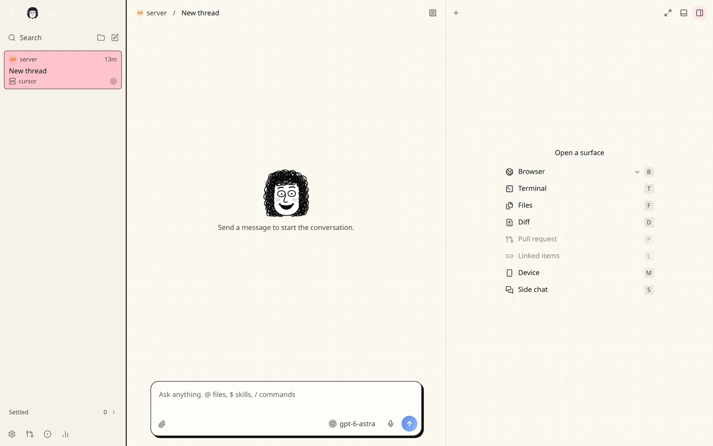

<p align="center">
  <a href="./README.md">English</a> · <strong>简体中文</strong>
</p>

<p align="center">
  <a href="https://old.lat/code/">
    
  </a>
</p>

<h1 align="center">Oldlee Code</h1>

<p align="center">
  
</p>

<p align="center">
  <a href="https://github.com/oldleeo/oldlee-code"><strong>源码</strong></a> ·
  <a href="https://github.com/oldleeo/oldlee-code/releases">发布</a> ·
  <a href="https://old.lat/code/">网站</a> ·
  <a href="./docs/README.md">文档</a>
</p>

Oldlee Code 是 [T3 Code](https://github.com/pingdotgg/t3code) 的非官方分支，和 T3 Tools, Inc. 没有隶属、背书或维护关系。它在你自己的电脑上驱动已经登录的编程代理。桌面、网页和手机看到的是同一批对话。

可以用 Claude Code、Codex、Cursor、OpenCode、Grok Build、Antigravity、Kiro、Pi、Muse Code、fx，以及任何 [ACP](./docs/user/providers-acp.md) 代理。

## 能做什么

- **用你自己的订阅。** 不转售 token，只驱动你已经登录的代理。
- **代理放在一处。** 对话中途可以换模型，也可以把任务交给另一个代理。
- **桌面、网页、手机。** 一台服务器。手机应用从本仓库构建，App Store 和 Google Play 上没有 Oldlee Code。
- **远程。** 代理可以跑在另一台机器上，通过局域网或 Tailscale 连接。Oldlee Connect 仍依赖本分支不运营的中继和账号服务。见[远程访问](./docs/user/remote-access.md)。
- **Git。** 一个对话可以用自己的 worktree。看完 diff，再提交、推送、开 pull request。

## 安装

命令行仍然是 `t3`。

按[开发手册](./docs/operations/00_development.md#first-checkout)从源码构建，或者等 [GitHub Releases](https://github.com/oldleeo/oldlee-code/releases) 发布后安装压缩包。

有 `curl` 的机器：

```bash
curl -fsSL https://raw.githubusercontent.com/oldleeo/oldlee-code/main/scripts/install.sh | sh
```

Windows PowerShell：

```powershell
irm https://raw.githubusercontent.com/oldleeo/oldlee-code/main/scripts/install.ps1 | iex
```

安装脚本会从这个仓库下载发布包。还没有发布时，请在本地构建。

### 登录一个代理

至少要有一个已经安装并登录的代理。例如安装 [Claude Code](https://claude.com/product/claude-code) 后运行 `claude auth login`，或安装 [Codex CLI](https://developers.openai.com/codex/cli) 后运行 `codex login`。

各代理的步骤见[配置代理](./docs/user/install.md#providers)。

## 文档

- [安装与第一次运行](./docs/user/install.md)
- [从手机或另一台机器远程访问](./docs/user/remote-access.md)
- [权限模式](./docs/user/permission-modes.md)
- [源码管理](./docs/user/source-control.md)
- [用 MCP 接入外部代理](./docs/user/outside-agents.md)
- [常见问题](./docs/user/faq.md)

[全部文档](./docs/README.md)。

## 参与

报 bug 或开 pull request 之前，先读 [CONTRIBUTING.md](./CONTRIBUTING.md)。从源码构建见[开发手册](./docs/operations/00_development.md#first-checkout)。[架构概览](./docs/internals/01_architecture.md)说明服务器是怎么组织的。

## 许可

本仓库的源码采用 [MIT 许可](./LICENSE)。上游的版权声明保持原样。

## 商标

Oldlee Code 是 T3 Code 的非官方分支。MIT 许可只覆盖源码，不授予 T3 Tools, Inc. 任何商标权利，包括 T3 Code 的名称、字标、标志和应用图标。这些都没有用在这里。见 [TRADEMARK.md](./TRADEMARK.md)。
